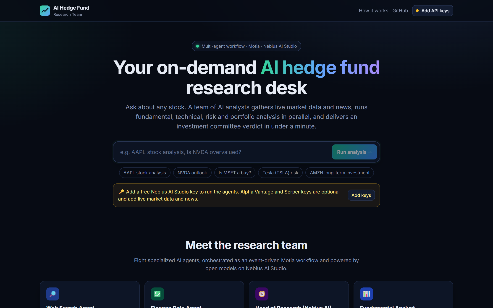
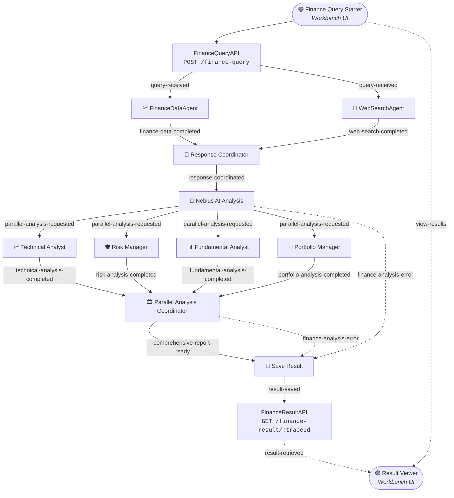
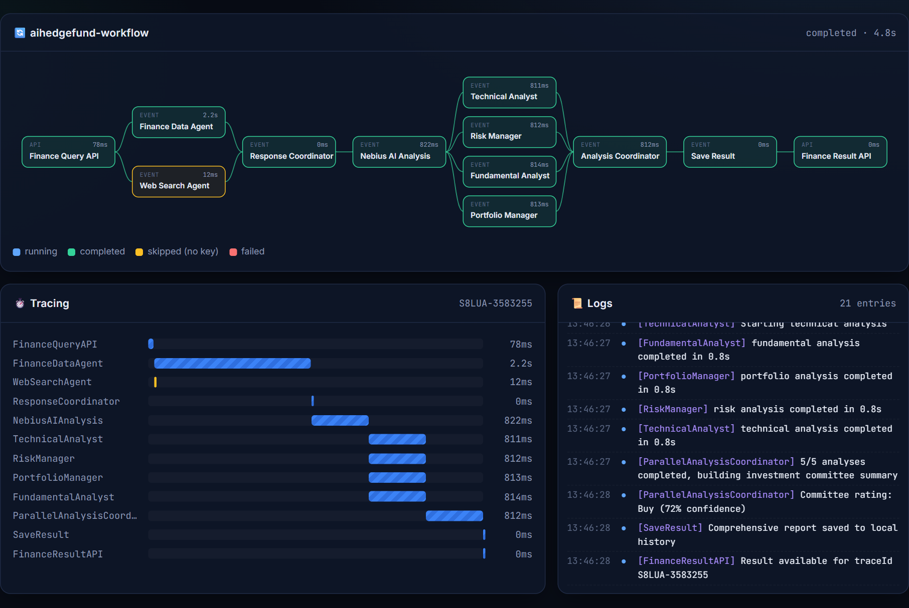

<div align="center">

# 🏦 AI Hedge Fund Research Team

### A team of AI analysts that researches any stock in under a minute

**Live market data · Web and news research · Parallel fundamental, technical, risk and portfolio analysis · Investment-committee verdict**

[](https://tirth1263.github.io/AI-Hedge-Fund-Research-Team/)

[](https://motia.dev)
[](https://nebius.com/ai-studio)
[](https://www.typescriptlang.org/)
[](https://react.dev)
[](#-docker-deployment)
[](LICENSE)



</div>

---

## ✨ What is this?

Hedge funds don't rely on one analyst. They run a **research desk**: someone gathers the data, a head of research frames the story, specialists dig into valuation, charts and risk, and an investment committee makes the final call.

**AI Hedge Fund Research Team** rebuilds that desk with AI agents. Type a question like *"AAPL stock analysis"* or *"Is NVDA overvalued?"* and an event-driven [Motia](https://motia.dev) workflow:

1. 🔎 **Collects data in parallel**: live quotes, fundamentals and price history from Alpha Vantage, plus Google web and news results from Serper.
2. 🧭 **Writes a market brief** with an open-weight LLM on **Nebius AI Studio**.
3. ⚡ **Fans out to four specialist agents at once** (Fundamental, Technical, Risk and Portfolio), each with its own persona and mandate.
4. 🏛️ **Convenes an investment committee** that merges everything into a **rating, confidence score, thesis and key risks**.
5. 💾 **Saves a structured report** you can fetch by `traceId` from the REST API or explore in the dashboard.

> **Try it now:** open the **[live dashboard](https://tirth1263.github.io/AI-Hedge-Fund-Research-Team/)**, paste a free Nebius API key, and run an analysis. The whole agent team runs directly in your browser.

---

## 🔧 Key features

| | Feature | Details |
|---|---|---|
| ⚡ | **Parallel processing** | Web search and financial data run at the same time, then four specialist agents run concurrently. A full report takes about as long as the slowest agent. |
| 🧠 | **State management** | Every run gets its own trace-isolated state. Results are stored per trace *and* in a global `finance-results` index, so they can be read in more than one way. |
| 🩹 | **Graceful degradation** | No market-data key? Web search rate-limited? An agent times out? The workflow logs it, marks that step, and the rest of the team carries on. |
| 📈 | **Real quant signals** | RSI(14), MACD, SMA20/50, Bollinger bands, annualized volatility, max drawdown, 1-day VaR(95), support and resistance, computed from real price data and fed to the agents. |
| 🔒 | **Type safety** | Zod-validated step inputs and API bodies, plus one shared TypeScript domain model across the backend and the dashboard. |
| 📜 | **Observability** | Structured logs with trace IDs, error topics, and a Motia Workbench showing the flow graph, tracing timeline, logs and state. |
| 🖥️ | **Interactive UI** | Custom React nodes in Motia Workbench, plus a standalone dashboard with a live pipeline graph, Gantt-style trace, logs, charts and the report. |
| 🐳 | **Deploy anywhere** | Dockerfile and Docker Compose for the backend; the dashboard is a static site deployed to GitHub Pages by GitHub Actions. |

---

## 🤖 Meet the agents

| Agent | Motia step | What it does |
|---|---|---|
| 🔎 **Web Search Agent** | `web-search.step.ts` | Google web and news search (Serper) for catalysts, earnings coverage and sentiment |
| 💹 **Finance Data Agent** | `finance-data.step.ts` | Quote, company overview and about 100 daily bars (Alpha Vantage), plus locally computed technical and risk indicators |
| 🔗 **Response Coordinator** | `response-coordinator.step.ts` | Waits for both data sources (fan-in), then merges them into one context |
| 🧭 **Head of Research** | `nebius-ai-analysis.step.ts` | General market and company brief: snapshot, sector context, recent developments, key questions |
| 📊 **Fundamental Analyst** | `fundamental-analyst.step.ts` | Valuation multiples, profitability, growth drivers, fair-value range, valuation verdict |
| 📈 **Technical Analyst** | `technical-analyst.step.ts` | Trend structure, momentum, key levels, trade setup with entry, stop and targets |
| 🛡️ **Risk Manager** | `risk-manager.step.ts` | Market and event risk, a risk matrix, downside protection, risk rating |
| 💼 **Portfolio Manager** | `portfolio-manager.step.ts` | Recommendation, position sizing by risk profile, entry and exit plan, diversification |
| 🏛️ **Investment Committee** | `parallel-analysis-coordinator.step.ts` | Fan-in of all four specialists into the final report and a JSON verdict (rating, confidence, thesis, risks) |

---

## 🏗️ Architecture



The dashboard animates the same graph live while the agents work, with a Motia-style tracing timeline and structured logs:



### How a request flows

| # | Topic | Producer → Consumer | Purpose |
|---|---|---|---|
| 1 | `query-received` | Query API → Finance Data, Web Search | Fan-out: parallel data collection |
| 2 | `finance-data-completed` / `web-search-completed` | Data agents → Response Coordinator | Fan-in: proceeds only when **both** are in state |
| 3 | `response-coordinated` | Coordinator → Nebius AI Analysis | General market brief |
| 4 | `parallel-analysis-requested` | Nebius AI → 4 specialists | Fan-out: four concurrent LLM agents |
| 5 | `*-analysis-completed` | Specialists → Analysis Coordinator | Fan-in: builds the report after 4/4 arrive (failed ones included) |
| 6 | `comprehensive-report-ready` | Coordinator → Save Result | Persist the report for the API and UI |
| ⚠️ | `finance-analysis-error` | Any stage → Save Result | Dedicated error topic; the failure is stored and queryable |

Large payloads (market data, analyses) live in **Motia state** under the run's `traceId`. Events carry only small signals, which keeps the queue light and every run isolated.

---

## 📁 Project structure

```
AI-Hedge-Fund-Research-Team/
├── services/                         # Shared business logic (used by Motia AND the web dashboard)
│   ├── nebius-ai/
│   │   ├── FinanceDataService.ts     # Alpha Vantage client + indicator pipeline
│   │   └── NebiusAIService.ts        # Nebius (OpenAI-compatible) client + agent personas & prompts
│   ├── types.ts                      # Shared domain model (reports, sections, events)
│   └── utils/
│       ├── ConfigService.ts          # Environment configuration
│       ├── helper-functions.ts       # Ticker extraction, RSI/MACD/VaR, prompt context, report assembly
│       ├── ServiceFactory.ts         # Lazy singletons for services
│       ├── specialist-runner.ts      # Shared body of the 4 parallel specialist steps
│       ├── StateService.ts           # Typed, trace-isolated state access
│       └── WebSearchService.ts       # Serper web + news search
├── steps/                            # Motia steps (each file = one node in the flow)
│   ├── api/
│   │   ├── query-api.step.ts         # POST /finance-query
│   │   └── result-api.step.ts        # GET  /finance-result/:traceId
│   ├── general/
│   │   ├── finance-data.step.ts
│   │   ├── nebius-ai-analysis.step.ts
│   │   ├── response-coordinator.step.ts
│   │   ├── save-result.step.ts
│   │   └── web-search.step.ts
│   ├── noop/
│   │   ├── 00-noop.step.ts / .tsx    # Finance Query Starter (custom Workbench UI)
│   │   └── 01-noop.step.ts / .tsx    # Result Viewer (custom Workbench UI)
│   └── parallel/
│       ├── fundamental-analyst.step.ts
│       ├── parallel-analysis-coordinator.step.ts
│       ├── portfolio-manager.step.ts
│       ├── risk-manager.step.ts
│       └── technical-analyst.step.ts
├── web/                              # Deployed dashboard (Vite + React 19, GitHub Pages)
│   └── src/
│       ├── engine/workflow.ts        # Browser runner of the same flow + Motia server client
│       └── components/               # Workflow graph, tracing, logs, report, charts, settings
├── .github/workflows/                # CI + GitHub Pages deployment
├── Dockerfile · docker-compose.yml   # Container deployment of the Motia backend
├── motia.config.ts                    # Workbench plugins (tracing, logs, states, endpoints)
├── env.example                       # Environment template
└── types.d.ts                        # Motia-generated handler types
```

---

## 🚀 Getting started

### Option 1: Use the hosted dashboard (no install)

1. Open **https://tirth1263.github.io/AI-Hedge-Fund-Research-Team/**
2. Click **Add API keys** and paste your [Nebius AI Studio key](https://tokenfactory.nebius.com). Optionally add [Alpha Vantage](https://www.alphavantage.co/support/#api-key) and [Serper](https://serper.dev) keys (both have free tiers) for live market data and news.
3. Type a ticker or question and press **Run analysis**.

> 🔐 In browser mode your keys go **only** from your browser to Nebius, Alpha Vantage and Serper. There is no middle-man server. Keys stay in session storage unless you tick *Remember on this device*.

### Option 2: Run the Motia backend locally

**Prerequisites:** Node.js 20+ (Docker optional)

```bash
# Clone the repository
git clone https://github.com/tirth1263/AI-Hedge-Fund-Research-Team.git
cd AI-Hedge-Fund-Research-Team

# Configure your keys
cp env.example .env        # then edit .env

# Install dependencies
npm install

# Start the development server + Motia Workbench
npm run dev                # → http://localhost:3000
```

Open **http://localhost:3000** to see the flow in **Motia Workbench**, start a query from the *Finance Query Starter* node, and watch the agents light up in the **Tracing**, **Logs** and **States** tabs.

> 💡 **Windows tip:** Motia starts an embedded Redis. If that fails on your machine, point it at an installed Redis/Memurai binary with `REDISMS_SYSTEM_BINARY=C:\path\to\redis-server.exe`, or simply use Docker.

### Option 3: Run the dashboard locally

```bash
npm --prefix web install
npm run web:dev            # → http://localhost:5173/AI-Hedge-Fund-Research-Team/
```

---

## 🔑 Environment variables

```bash
# Required
NEBIUS_API_KEY=your_actual_nebius_api_key
NEBIUS_BASE_URL=https://api.tokenfactory.nebius.com/v1
NEBIUS_MODEL=Qwen/Qwen3-14B

# Optional (the workflow degrades gracefully without them)
ALPHA_VANTAGE_KEY=your_alpha_vantage_api_key_here
SERPER_API_KEY=your_serper_api_key_here
```

| Variable | Required | Description |
|---|:-:|---|
| `NEBIUS_API_KEY` | ✅ | Nebius AI Studio / Token Factory API key |
| `NEBIUS_BASE_URL` | | OpenAI-compatible endpoint (default `https://api.tokenfactory.nebius.com/v1`) |
| `NEBIUS_MODEL` | | Any chat model on your account, e.g. `Qwen/Qwen3-14B`, `meta-llama/Llama-3.3-70B-Instruct` |
| `ALPHA_VANTAGE_KEY` | | Real-time quotes, fundamentals and daily prices (`ALPHA_VINTAGE_KEY` also accepted) |
| `SERPER_API_KEY` | | Google web and news search |
| `NEBIUS_TEMPERATURE` / `NEBIUS_MAX_TOKENS` | | Optional generation tuning (defaults `0.4` / `2200`) |

---

## 🧪 Usage

### Starting the workflow

1. **Via UI:** use the *Finance Query Starter* node in Motia Workbench, or the [web dashboard](https://tirth1263.github.io/AI-Hedge-Fund-Research-Team/)
2. **Via API:** send a `POST` request to `/finance-query` with a query payload
3. **Via NOOP:** trigger the flow manually from the NOOP node in the Workbench

### Example API request

```bash
curl -X POST http://localhost:3000/finance-query \
  -H "Content-Type: application/json" \
  -d '{"query": "AAPL stock analysis"}'
```

```json
{
  "traceId": "F4GB8-5011529",
  "status": "processing",
  "message": "Analysis started. Poll the result URL to retrieve the report.",
  "resultUrl": "/finance-result/F4GB8-5011529"
}
```

### Retrieving results

```bash
curl http://localhost:3000/finance-result/{traceId}
```

While the run is in progress you get `"status": "processing"` plus a live `progress` map (`webSearch`, `financeData`, `general`, `fundamental`, `technical`, `risk`, `portfolio`). When it finishes:

<details>
<summary><b>📄 Sample output (abridged)</b></summary>

```jsonc
{
  "traceId": "F4GB8-5011529",
  "status": "completed",
  "query": "AAPL stock analysis",
  "comprehensiveReport": {
    "symbol": "AAPL",
    "summary": "Comprehensive Financial Analysis Report for Apple Inc: 5/5 analyses completed.",
    "executiveSummary": {
      "rating": "Buy",                 // Strong Buy | Buy | Hold | Sell | Strong Sell
      "confidence": 70,
      "thesis": "…",
      "keyPoints": ["…"],
      "risks": ["…"],
      "timeHorizon": "6-12 months"
    },
    "sections": {
      "general":     { "title": "General Market Analysis",       "status": "completed", "summary": "…", "details": "## Snapshot …" },
      "fundamental": { "title": "Fundamental Analysis",          "status": "completed", "details": "## Valuation …" },
      "technical":   { "title": "Technical Analysis",            "status": "completed", "details": "## Trend Structure …" },
      "risk":        { "title": "Risk Assessment",               "status": "completed", "details": "## Market Risk …" },
      "portfolio":   { "title": "Portfolio Management Insights", "status": "completed", "details": "## Recommendation …" }
    },
    "marketData": {
      "quote":      { "price": 0, "changePercent": 0, "latestTradingDay": "…" },
      "overview":   { "name": "Apple Inc", "sector": "TECHNOLOGY", "peRatio": 0, "marketCap": 0 },
      "indicators": { "rsi14": 0, "sma20": 0, "sma50": 0, "annualizedVolatility": 0, "maxDrawdown": 0, "trend": "uptrend" },
      "history":    [ /* ~100 daily OHLCV bars */ ]
    },
    "sources": [ { "title": "…", "link": "…", "source": "…" } ],
    "completedAnalyses": ["general", "fundamental", "technical", "risk", "portfolio"],
    "failedAnalyses": [],
    "disclaimer": "This report is generated by AI models for research and educational purposes only. …"
  }
}
```

Numbers above are placeholders; real runs fill them with live data.

</details>

---

## 🐳 Docker deployment

### Set up environment variables

```bash
cp env.example .env   # then add your API keys
```

### Run with Docker Compose

```bash
# Start the application
docker compose up -d

# View logs
docker compose logs -f

# Stop the application
docker compose down
```

### Run with environment variables directly

```bash
export NEBIUS_API_KEY=your_key
export ALPHA_VANTAGE_KEY=your_key
export SERPER_API_KEY=your_key
docker compose up -d
```

### Simple Docker build and run

```bash
# Build the image
docker build -t ai-hedgefund .

# Run with environment variables
docker run -p 3000:3000 -e NEBIUS_API_KEY=your_key ai-hedgefund
```

The image bundles `redis-server` for Motia's state and stream adapters and runs `motia start` on port `3000` (Workbench included; set `MOTIA_DOCKER_DISABLE_WORKBENCH=true` for an API-only container). It runs on any container host: Render, Railway, Fly.io, Google Cloud Run, AWS App Runner, Azure Container Apps or a VPS.

### Connect the dashboard to your server

Once your backend is deployed, open the dashboard → **Settings** → **🖥️ Motia server**, and paste your server URL. The dashboard calls `POST /finance-query`, polls `GET /finance-result/:traceId`, and animates the pipeline from the server's live `progress` map. Your API keys then stay on the server.

---

## 🖥️ The web dashboard

The dashboard (`/web`) is a static React app deployed to **GitHub Pages** on every push by GitHub Actions. It imports the **same `services/` modules** as the Motia steps (identical prompts, data pipeline and report format), so it can run the full agent team in two ways:

| Mode | Where agents run | Keys live | Best for |
|---|---|---|---|
| 🌐 **Browser** | In your browser (Nebius, Alpha Vantage and Serper all allow direct browser calls) | Your browser only | Instant demo, no backend |
| 🖥️ **Motia server** | Your deployed Motia backend | Server environment | Teams, production, Workbench observability |

What you see:

- 🔄 **Live workflow graph**: every agent lights up as it runs, completes, is skipped or fails
- ⏱️ **Tracing timeline**: a Gantt chart of step durations, like Motia Workbench's tracing tab
- 📜 **Structured logs** from every agent
- 🏛️ **Investment committee verdict** with rating and confidence meter
- 📈 **Interactive price chart** (close, SMA20, SMA50) and a key-metrics grid
- 🗂️ **Tabbed analyses** in rich Markdown, linked **sources**, and the raw **JSON** report (downloadable)
- 🕘 **Recent reports** history kept locally

---

## 🧰 Tech stack

| Layer | Technology |
|---|---|
| Workflow orchestration | [Motia](https://motia.dev): event-driven steps, state, streams, Workbench |
| LLM inference | [Nebius AI Studio](https://nebius.com/ai-studio) (OpenAI-compatible; Qwen3, Llama 3.3, DeepSeek and more) |
| Market data | [Alpha Vantage](https://www.alphavantage.co): quotes, fundamentals, daily time series |
| Web research | [Serper](https://serper.dev): Google search and news |
| Language and validation | TypeScript, Zod |
| Dashboard | React 19, Vite 6, react-markdown, hand-built SVG charts |
| Delivery | Docker, Docker Compose, GitHub Actions, GitHub Pages |

---

## 🧠 Design notes

- **Fan-in with state, not payloads.** Coordinators read sibling results from trace-scoped state and continue only when every input is present. A best-effort lock in state stops double triggering when siblings finish at the same moment.
- **Failure is a value.** Each agent always emits its `*-completed` event, with `status: failed` and an error if needed, so a single failing model call can never stall the pipeline. Only when *nothing* succeeds does the run go to the `finance-analysis-error` topic.
- **Reasoning-model friendly.** `<think>…</think>` blocks from reasoning models (Qwen3, DeepSeek-R1) are stripped, and Qwen3 models get `/no_think` for faster, cleaner reports.
- **Rate-limit aware.** The Alpha Vantage client spaces its requests and falls back to the latest daily bar when the quote endpoint is throttled.
- **One source of truth.** `services/` has no Node-only dependencies on its hot path (`fetch` everywhere), so the backend and the dashboard share the exact same logic.

---

## 🗺️ Roadmap

- [ ] Streaming partial reports to the UI with Motia Streams
- [ ] Multi-ticker portfolio analysis and comparison mode
- [ ] Earnings-call transcript and SEC filings agent
- [ ] Scheduled watchlist reports with Motia cron steps
- [ ] Backtesting the committee's historical calls

Contributions, ideas and issues are welcome. Feel free to open a PR!

---

## ⚠️ Disclaimer

This project is for **research and educational purposes only**. The reports are generated by AI models, can be wrong, and are **not investment advice**. Always do your own research and consult a licensed financial advisor before making investment decisions.

## 📄 License

Released under the [MIT License](LICENSE).

## 🙏 Acknowledgements

Inspired by the *AI Hedge Fund* example in [awesome-ai-apps](https://github.com/Arindam200/awesome-ai-apps). Built on the excellent [Motia](https://github.com/MotiaDev/motia) framework and [Nebius AI Studio](https://nebius.com/ai-studio).

<div align="center">

**If you find this project useful, please consider giving it a ⭐!**

Made with ❤️ by [Tirth](https://github.com/tirth1263)

</div>
